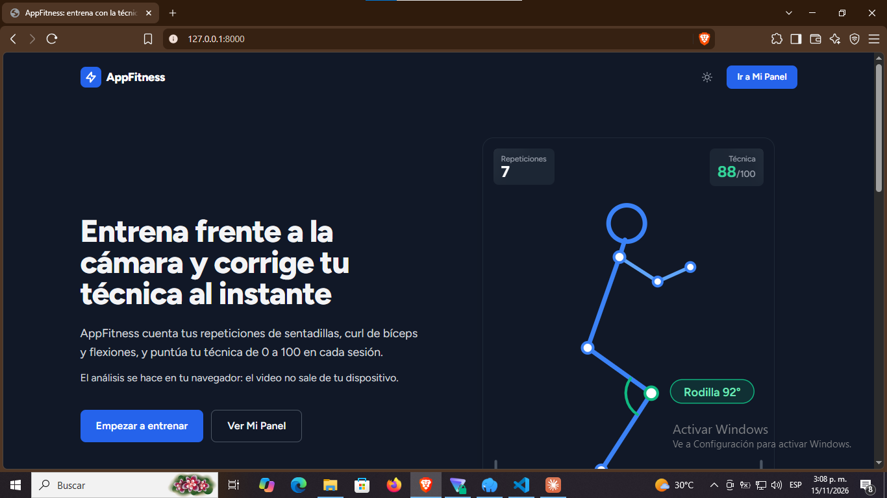
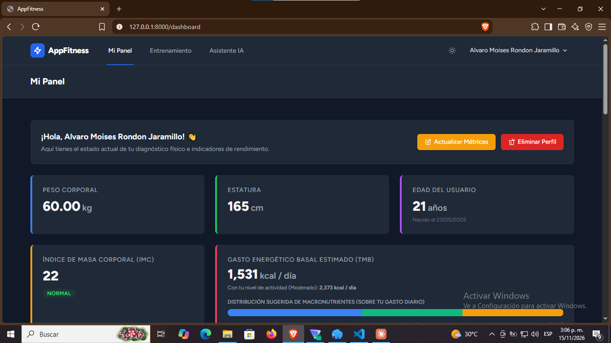
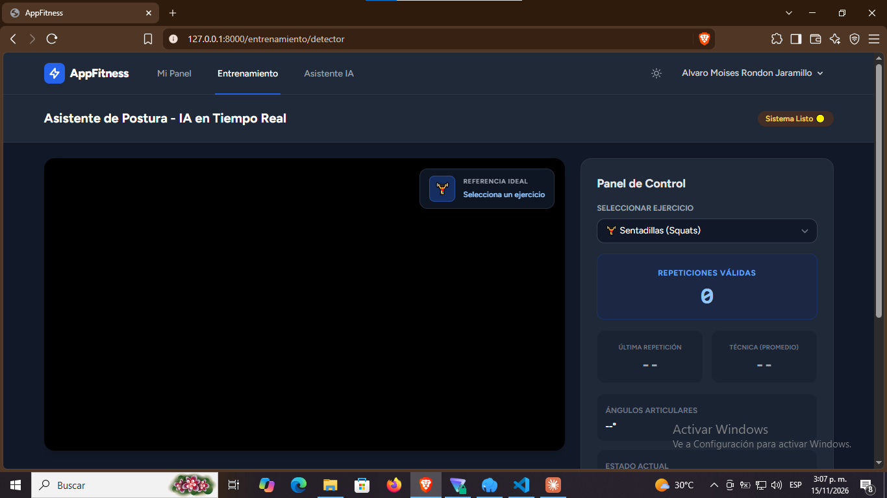
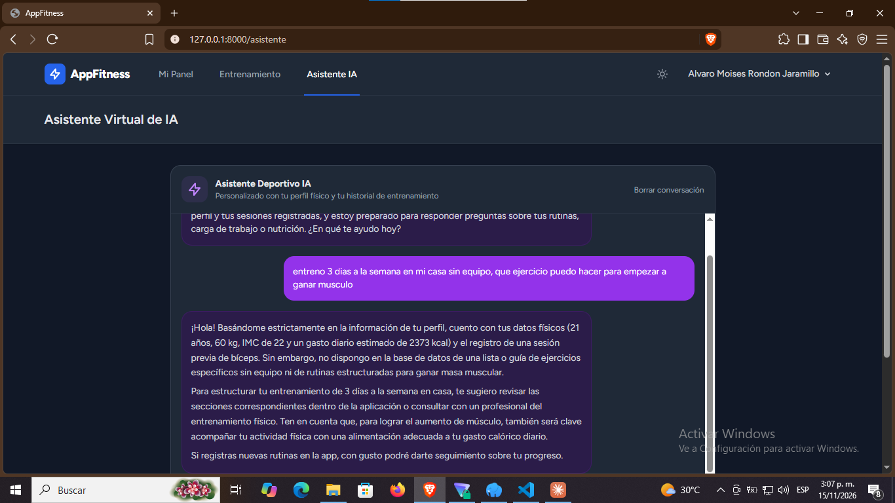
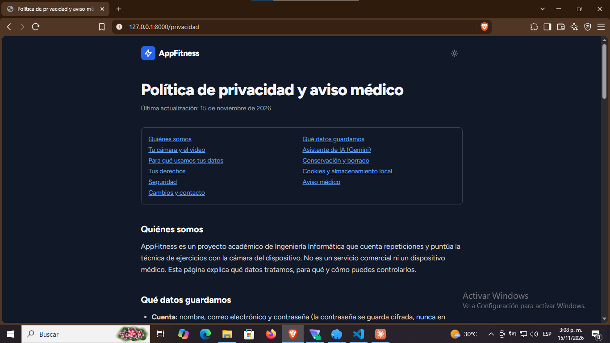

# AppFitness

Aplicación web que cuenta repeticiones y puntúa la técnica de ejercicios usando la cámara del dispositivo, con un panel de progreso y un asistente de IA que da recomendaciones personalizadas.

Es un proyecto académico de Ingeniería Informática. No es un servicio comercial ni un dispositivo médico.



## Funciones

- **Detector de postura:** usa MediaPipe Pose directamente en el navegador. Cuenta repeticiones válidas por ciclo completo y puntúa la técnica de 0 a 100. Ejercicios disponibles: sentadilla, bíceps, flexión, salto de tijera y elevación de rodillas.
- **Mi Panel:** resumen del rendimiento con gráficas (repeticiones por semana, evolución de la técnica y sesiones por ejercicio), meta semanal de 3 sesiones, racha de días y últimas sesiones.
- **Perfil físico:** peso, estatura, fecha de nacimiento, género, nivel de actividad y condiciones médicas opcionales. Calcula IMC, gasto basal, gasto diario y un reparto base de macronutrientes.
- **Asistente de IA:** consultas a Gemini con el contexto del perfil y los entrenamientos del usuario, con memoria de la conversación.
- **Panel de administración:** rol de administrador con resumen global (usuarios, sesiones, ejercicio más usado), gestión de usuarios (buscar, ver resumen, cambiar rol, desactivar o eliminar), gestión del catálogo de ejercicios (nombre, descripción y activar o desactivar) y supervisión del asistente de IA con datos técnicos de uso, sin el contenido de las conversaciones.
- **Privacidad:** política y aviso médico públicos, consentimiento al registrarse, exportación de los datos en JSON y borrado de la cuenta con todos sus datos.
- **Modo claro y oscuro** en toda la aplicación.







## Administración

Las cuentas tienen un rol: `user` (por defecto) o `admin`. Nadie puede volverse administrador desde el registro ni desde un formulario: el primero se crea con un seeder y después otro administrador puede cambiar el rol de una cuenta.

```powershell
php artisan db:seed --class=AdminSeeder
```

Crea `admin@appfitness.test` con la contraseña `password` (solo para uso local; cámbiala o define `ADMIN_EMAIL` y `ADMIN_PASSWORD` en el `.env`). El enlace **Administración** aparece solo para administradores y lleva a `/admin`:

- **Resumen:** usuarios, nuevos, activos de la semana, sesiones, repeticiones, técnica promedio y sesiones por ejercicio y por semana.
- **Usuarios:** buscador, ficha con el resumen de entrenamiento, cambio de rol, desactivar o reactivar la cuenta y eliminarla (pide la contraseña del administrador).
- **Ejercicios:** editar nombre y descripción, y activar o desactivar. Un ejercicio desactivado no aparece en el detector ni admite sesiones nuevas. No se pueden crear ejercicios nuevos desde el panel porque la lógica de cada uno vive en el detector.
- **Asistente IA:** consultas por día, tasa de éxito, resultados, modelos y un registro técnico. No muestra preguntas ni respuestas.

Protecciones: un administrador no puede cambiar su propio rol, desactivarse ni eliminarse desde el panel, ni actuar sobre otro administrador sin quitarle antes el rol. El único administrador tampoco puede borrar su cuenta desde Mi cuenta. Un administrador no ve los datos del perfil físico (peso, estatura, condiciones médicas) ni el contenido de las conversaciones; la política de privacidad lo explica.

## Privacidad del video

El video de la cámara se procesa en el navegador y **no se envía ni se guarda en ningún servidor**. De cada entrenamiento solo se guarda un resumen numérico: ejercicio, repeticiones, duración y puntaje.

Los datos que se envían a Gemini cuando se usa el asistente están descritos en la [política de privacidad](docs/capturas/privacidad.png) de la aplicación (ruta `/privacidad`).

## Tecnologías

| Capa | Tecnología |
|---|---|
| Backend | Laravel 13 con Breeze, PHP 8.3, Composer 2.9 |
| Base de datos | MySQL (Laragon) |
| Frontend | Blade, Tailwind CSS 3 (`darkMode: 'class'`), Alpine.js, Vite |
| Gráficas | Chart.js |
| Visión por computador | MediaPipe Pose (local, en el navegador) |
| Asistente de IA | API de Gemini |

## Instalación en Laragon (Windows)

Requisitos: Laragon con PHP 8.3 y MySQL, Composer, Node.js con npm y Git.

1. Clona el repositorio dentro de `C:\laragon\www`:

   ```powershell
   git clone https://github.com/AlvaroRondon23/appfitness.git appfitness-api
   cd appfitness-api
   ```

2. Instala las dependencias:

   ```powershell
   composer install
   npm install
   ```

3. Crea el archivo de entorno y la clave de la aplicación:

   ```powershell
   copy .env.example .env
   php artisan key:generate
   ```

4. Crea una base de datos vacía llamada `appfitness_db` (por ejemplo desde HeidiSQL, incluido en Laragon) y revisa en el `.env` los datos de conexión.

5. Ejecuta las migraciones:

   ```powershell
   php artisan migrate
   ```

6. Inicia Vite en una terminal y déjala abierta (sin Vite la interfaz no tiene estilos):

   ```powershell
   npm run dev
   ```

7. En otra terminal inicia el servidor, o usa el host virtual de Laragon:

   ```powershell
   php artisan serve
   ```

## Configuración del `.env`

Valores principales (nunca subas tu `.env` ni tus claves al repositorio):

```env
APP_NAME=AppFitness
APP_LOCALE=es
APP_TIMEZONE=America/Caracas
APP_DEBUG=true            # solo en local

DB_CONNECTION=mysql
DB_HOST=127.0.0.1
DB_PORT=3306
DB_DATABASE=appfitness_db
DB_USERNAME=root
DB_PASSWORD=

GEMINI_API_KEY=           # tu clave de Gemini; solo en .env
# ADMIN_EMAIL=            # opcional: correo del primer administrador (AdminSeeder)
# ADMIN_PASSWORD=         # opcional: contraseña inicial del administrador (solo se usa al crear la cuenta)
# GEMINI_MODELS=          # opcional: modelos separados por coma; si se omite se usan los de config/services.php
```

- La clave de Gemini se obtiene en Google AI Studio. Sin ella, el resto de la aplicación funciona y el asistente muestra un mensaje de error amable.
- El correo no se usa: `MAIL_MAILER` queda en `log`.
- En producción, `APP_DEBUG` debe ser `false`.

## Primeros pasos con tu cuenta

1. Abre la aplicación y pulsa **Registrarse**. Escribe nombre, correo y contraseña, y marca la casilla que acepta la política de privacidad y el aviso médico.
2. La primera vez te pedirá completar tu **perfil físico** (peso, estatura, fecha de nacimiento, género y nivel de actividad). Las condiciones médicas son opcionales. Puedes editarlo después desde Mi Panel.
3. Entra a **Entrenar**, elige el ejercicio, permite el acceso a la cámara y colócate de modo que se vea tu cuerpo completo en un espacio despejado. Para el salto de tijera y la elevación de rodillas, ponte de frente a la cámara.
4. Al terminar, la sesión se guarda y aparece en **Mi Panel** con tus gráficas y tu progreso hacia la meta semanal.
5. En **Asistente** puedes preguntar sobre ejercicio, nutrición o descanso. Las respuestas usan tu perfil y tus sesiones.
6. En **Mi cuenta** puedes cambiar tus datos y contraseña, descargar tus datos en JSON o eliminar la cuenta.
7. Si eres administrador, entra por el enlace **Administración**. Un administrador sin perfil físico no está obligado a crearlo.



## Pruebas

Las pruebas usan SQLite en memoria, así que no tocan tu base MySQL. Necesitas la extensión `pdo_sqlite` de PHP activa.

```powershell
php artisan test
```

Cubren la autenticación, el registro con consentimiento, los cálculos del perfil (`PerfilCalculos`), las estadísticas (`EstadisticasEntrenamiento`), la exportación de datos, el borrado de cuenta en cascada y el guardado de sesiones con los ejercicios del catálogo, el rol de administrador y sus protecciones, la gestión del catálogo y el registro técnico del asistente.

## Aviso médico

La información de AppFitness es orientativa. El IMC, el gasto calórico, los macronutrientes, el puntaje de técnica y las respuestas del asistente de IA son estimaciones y no reemplazan la opinión de un médico, nutricionista o entrenador. Consulta a un profesional de la salud antes de empezar o cambiar un programa de ejercicio, y detente si sientes dolor o malestar.

## Estructura básica

```
app/Http/Controllers/   Controladores (asistente, perfil físico, sesiones, cuenta)
app/Http/Controllers/Admin/   Panel de administración (resumen, usuarios, ejercicios, asistente)
app/Http/Middleware/    CheckPhysicalProfile, EsAdmin, CuentaActiva
app/Services/           ContextoAtleta, EstadisticasEntrenamiento, EstadisticasGlobales, PerfilCalculos, BorradoCuenta
resources/views/        Vistas Blade (portada, panel, detector, asistente, privacidad)
tests/                  Pruebas unitarias y de funcionalidad
```
